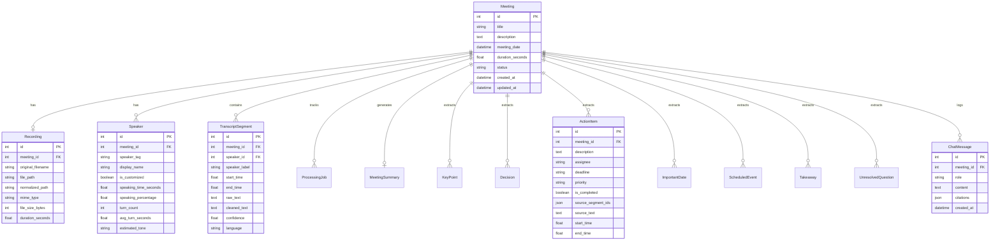
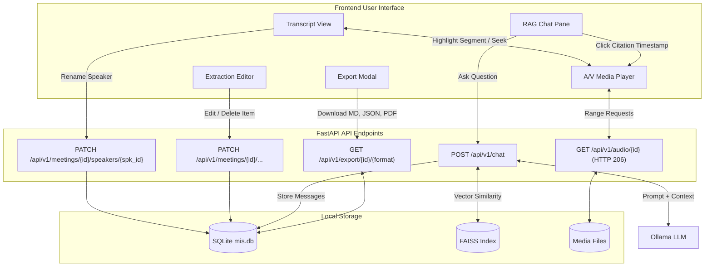
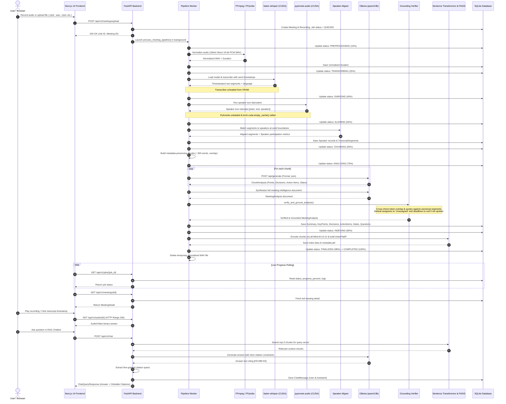

# Meeting Intelligence System (MIS) — Application Architecture & Workflow

> **100% Local-First, Privacy-Preserving AI Meeting Intelligence System**  
> Complete technical summary of the application architecture, models used, database schemas, grounding guarantees, and end-to-end processing pipelines.

---

## 1. Executive Application Summary

The **Meeting Intelligence System (MIS)** is a full-stack, local-first enterprise solution designed to convert raw meeting audio and video recordings into structured, auditable meeting intelligence without relying on external third-party cloud APIs.

```
       +--------------------------------------------------------------+
       |             Next.js 14 Frontend (React 18 / Tailwind)        |
       |  - Web Audio Recorder             - Synchronized A/V Player  |
       |  - Real-time Pipeline Tracker     - Speaker Management       |
       |  - Grounded Extraction Editor     - RAG Chatbot & Citations  |
       +------------------------------+-------------------------------+
                                      | HTTP REST / Range Requests
                                      v
       +--------------------------------------------------------------+
       |               FastAPI Backend Engine (Python 3.12)           |
       |  - Background Task Worker         - SQLite ORM (SQLAlchemy)  |
       |  - Range-Enabled Media Streamer   - Anti-Hallucination Guard |
       +------------------------------+-------------------------------+
                                      |
         +----------------------------+----------------------------+
         | Sequential GPU Pipeline    | Independent Services       |
         v                            v                            v
  +--------------+             +--------------+             +--------------+
  | faster-      |             | pyannote     |             | Ollama       |
  | whisper      |             | audio 3.1    |             | (Qwen3:8b)   |
  | (CUDA fp16)  |             | (Diarize)    |             | (Structured) |
  +--------------+             +--------------+             +--------------+
         |                            |                            |
         +-------------+--------------+                            |
                       v                                           v
         +----------------------------+             +----------------------+
         | Alignment & Semantic Chunk |             | FAISS Vector Search  |
         | (Word-level boundary match)|             | (all-MiniLM-L6-v2)   |
         +----------------------------+             +----------------------+
```

### Core Value Propositions
- **Zero Cloud Leakage**: Ingested audio, transcribed text, synthesized summaries, vector indices, and chat interactions remain entirely on the local machine (`127.0.0.1`).
- **GPU Memory Orchestration**: Engineered for consumer and laptop GPUs (e.g., NVIDIA RTX 4060 with 8 GB VRAM) by running memory-intensive neural stages sequentially and executing explicit VRAM eviction (`torch.cuda.empty_cache()` + garbage collection) between transcription, diarization, and LLM inference.
- **Strict Evidence Grounding**: Implements an anti-hallucination verification engine that verifies every LLM extraction against spoken canonical transcript segments, refusing to invent fictitious assignees, fabricated deadlines, or ungrounded conclusions.
- **Interactive Multi-Modal Interface**: Provides synchronized media playback with HTTP 206 Partial Content streaming, live transcript time-scrubbing, global speaker renaming cascades, structured extraction editing, and multi-format exports (Markdown, JSON, and PDF).

---

## 2. Models & Technologies Inventory

The system combines specialized speech, audio, embedding, and language models with local storage and frontend technologies:

### 2.1 AI & Machine Learning Models

| Function / Task | Primary Model | Fallback Model | Framework / Runtime | Hardware Target |
|---|---|---|---|---|
| **Speech-to-Text (ASR)** | `openai/whisper-large-v3-turbo` | `base.en` | [`faster-whisper`](file:///d:/Programs/MIS/backend/app/services/transcriber.py) (CTranslate2) | CUDA `float16` / CPU `int8` |
| **Speaker Diarization** | `pyannote/speaker-diarization-3.1` | Heuristic Single/Interval | [`pyannote.audio`](file:///d:/Programs/MIS/backend/app/services/diarizer.py) (PyTorch) | CUDA `float32` / CPU fallback |
| **LLM Reasoning & Extractions** | `qwen3:8b` | `qwen2.5:7b`, `llama3.2:3b`, `mistral:7b` | [Ollama](file:///d:/Programs/MIS/backend/app/services/llm_service.py) REST API (`/api/generate`) | Local GPU / VRAM (~5.2 GB) |
| **Heuristic Fallback Extractor** | Rule-based regex & linguistic patterns | Deterministic extraction | Python NLP heuristics | CPU (Instant) |
| **Dense Text Embeddings** | `sentence-transformers/all-MiniLM-L6-v2` | Deterministic 384-dim hash embedder | [`sentence-transformers`](file:///d:/Programs/MIS/backend/app/services/vector_store.py) (PyTorch) | CPU (~120 MB RAM) |
| **Vector Index & Similarity** | Meta `FAISS` (`IndexFlatIP` — Inner Product) | N/A | `faiss-cpu` | In-Memory / Disk (`.faiss`) |
| **Audio / Video Processing** | FFmpeg & FFprobe (16kHz Mono 16-bit PCM WAV) | N/A | Subprocess CLI (`ffmpeg`, `ffprobe`) | CPU |

---

### 2.2 Relational Database Models (SQLAlchemy ORM)

All structured metadata is persisted locally in `backend/instance/mis.db` via [`db_models.py`](file:///d:/Programs/MIS/backend/app/models/db_models.py):



#### Key Database Entities
1. [`Meeting`](file:///d:/Programs/MIS/backend/app/models/db_models.py#L14): Master record holding title, description, timestamp, duration, status, and foreign key cascades.
2. [`Recording`](file:///d:/Programs/MIS/backend/app/models/db_models.py#L42): File location on disk, MIME type, size, duration, and dynamic video stream detection (`is_video`).
3. [`Speaker`](file:///d:/Programs/MIS/backend/app/models/db_models.py#L72): Stores cluster tags (`SPEAKER_00`), user-customized display names, participation stats (time, percentage, turns, average turn length), and AI tone observations.
4. [`TranscriptSegment`](file:///d:/Programs/MIS/backend/app/models/db_models.py#L90): Timestamped speech segment bounded by `start_time` and `end_time`, containing word confidences and speaker attribution.
5. [`ProcessingJob`](file:///d:/Programs/MIS/backend/app/models/db_models.py#L108): Background task execution state, progress percentage (0–100%), current step message, and execution logs.
6. [`MeetingSummary`](file:///d:/Programs/MIS/backend/app/models/db_models.py#L125): Executive summary text, agenda topics list, overall sentiment estimate, and tone justification.
7. **Structured Extraction Tables**:
   - [`KeyPoint`](file:///d:/Programs/MIS/backend/app/models/db_models.py#L140): Categorized discussion points with source segment links.
   - [`Decision`](file:///d:/Programs/MIS/backend/app/models/db_models.py#L156): Formal decisions, context, impact, and spoken evidence.
   - [`ActionItem`](file:///d:/Programs/MIS/backend/app/models/db_models.py#L173): Action descriptions, assignees (guaranteed non-hallucinated or `Unassigned`), deadlines, priorities, and completion checkboxes.
   - [`ImportantDate`](file:///d:/Programs/MIS/backend/app/models/db_models.py#L192): Spoken date references, normalized ISO dates, and `needs_confirmation` flags.
   - [`ScheduledEvent`](file:///d:/Programs/MIS/backend/app/models/db_models.py#L210): Event titles, dates, and identified participants.
   - [`Takeaway`](file:///d:/Programs/MIS/backend/app/models/db_models.py#L228): Strategic takeaways and category groupings.
   - [`UnresolvedQuestion`](file:///d:/Programs/MIS/backend/app/models/db_models.py#L244): Open questions, speakers who raised them, and discussion context.
8. [`ChatMessage`](file:///d:/Programs/MIS/backend/app/models/db_models.py#L261): RAG conversation history storing user prompts, assistant answers, and citation arrays (`segment_id`, `start_time`, `end_time`, `text`, `speaker_label`).

---

### 2.3 Pydantic Data & Validation Schemas

Data exchange between the API, the LLM, and the frontend is validated using Pydantic v2 schemas:
- [`ChunkAnalysis`](file:///d:/Programs/MIS/backend/app/schemas/analysis.py#L88): Intermediate per-chunk extraction schema used during map-reduce processing.
- [`MeetingAnalysis`](file:///d:/Programs/MIS/backend/app/schemas/analysis.py#L101): Complete synthesized meeting intelligence schema generated by Ollama in structured JSON mode.
- [`ChatQueryRequest`](file:///d:/Programs/MIS/backend/app/schemas/chat.py#L15) & [`ChatQueryResponse`](file:///d:/Programs/MIS/backend/app/schemas/chat.py#L20): RAG request payload and response schema featuring fine-grained [`Citation`](file:///d:/Programs/MIS/backend/app/schemas/chat.py#L5) spans.
- [`MeetingDetail`](file:///d:/Programs/MIS/backend/app/schemas/meeting.py#L115): Full payload returned to the frontend containing the meeting, recording, speakers, transcript, all extractions, and summary.

---

## 3. End-to-End System Workflow

The Meeting Intelligence System follows a sequential, event-driven background pipeline. Every meeting advances through 11 well-defined lifecycle states:

```
[UPLOADED] ──> [QUEUED] ──> [PREPROCESSING] ──> [TRANSCRIBING] ──> [DIARIZING] ──> [ALIGNING]
                                                                                     │
[COMPLETED] <── [FINALIZING] <── [INDEXING] <── [ANALYZING] <── [CHUNKING] <─────────┘
     │
     └── [FAILED] (on unhandled error)
```

### Detailed Pipeline Stage Breakdown

#### 1. Ingestion & Validation (`UPLOADED` -> `QUEUED`)
- **Trigger**: File upload via drag & drop or in-browser live recording via HTML5 Web Audio API / `MediaRecorder`.
- **Validation**:
  - File extension check: `.mp3`, `.wav`, `.m4a`, `.mp4`, `.webm`, `.flac`, `.ogg`, `.mkv`, `.aac`.
  - File size cap: 500 MB limit enforced during stream ingestion.
- **Action**: Generates a UUID filename, saves media to `instance/uploads/`, registers `Meeting`, `Recording`, and `ProcessingJob` records in SQLite, and launches [`process_meeting_pipeline`](file:///d:/Programs/MIS/backend/app/services/pipeline_worker.py#L84) asynchronously via FastAPI `BackgroundTasks`.

#### 2. Media Preprocessing (`PREPROCESSING`)
- **Worker**: [`audio_processor.py`](file:///d:/Programs/MIS/backend/app/services/audio_processor.py).
- **Action**:
  - Runs FFmpeg subprocess to normalize arbitrary audio or video files into standardized **16kHz mono 16-bit PCM WAV** (`meeting_{id}_norm.wav`).
  - Calls `ffprobe` to compute true audio duration and inspect video streams (ignoring still album art).
  - Updates `Recording.duration_seconds` and `Meeting.duration_seconds`.

#### 3. Timestamped Transcription (`TRANSCRIBING`)
- **Worker**: [`transcriber.py`](file:///d:/Programs/MIS/backend/app/services/transcriber.py) wrapping `faster-whisper`.
- **Hardware Acceleration**:
  - Automatically checks for NVIDIA CUDA DLLs (`cublas64_12.dll`) and CTranslate2 support.
  - Device: `cuda` with `float16` compute type (or automatic fallback to `cpu` with `int8`).
- **Inference Configuration**:
  - Beam size: 5, language: `en`, VAD filter enabled (`min_silence_duration_ms=400`), `word_timestamps=True`.
- **VRAM Cleanup**: Unloads the Whisper model after transcription.

#### 4. Speaker Diarization (`DIARIZING`)
- **Worker**: [`diarizer.py`](file:///d:/Programs/MIS/backend/app/services/diarizer.py) wrapping `pyannote/speaker-diarization-3.1`.
- **Authentication**: Checks for `HF_TOKEN`. If not provided or gated terms are unaccepted, gracefully proceeds in single/unknown speaker fallback mode without throwing errors.
- **Inference**: Produces millisecond-accurate speaker turn intervals `[{start, end, speaker}]`.
- **VRAM Eviction**: Pipeline immediately unloads the model, forces Python garbage collection (`gc.collect()`), and clears CUDA cache (`torch.cuda.empty_cache()`) to guarantee full VRAM availability for Ollama.

#### 5. Boundary Alignment & Analytics (`ALIGNING`)
- **Worker**: [`aligner.py`](file:///d:/Programs/MIS/backend/app/services/aligner.py).
- **Algorithm**:
  - Matches transcript segments with speaker intervals using maximum time-overlap scoring.
  - Where word timestamps exist, splits multi-speaker segments at exact word boundaries.
  - Maps internal tags (`SPEAKER_00`, `SPEAKER_01`) to human-readable defaults (`Speaker 1`, `Speaker 2`).
  - Calculates participation statistics: total speaking time, speech percentage, turn counts, and average turn duration.
  - Persists `Speaker` and `TranscriptSegment` records to SQLite.

#### 6. Semantic Chunking (`CHUNKING`)
- **Worker**: [`chunker.py`](file:///d:/Programs/MIS/backend/app/services/chunker.py).
- **Algorithm**:
  - Aggregates consecutive transcript segments into chunks of ~350–400 words with 40–50 words overlap.
  - Preserves exact segment IDs, speaker attribution, and formatted timestamp prefixes `[HH:MM:SS] Speaker: Text`.
  - Ensures sentences are never truncated mid-phrase.

#### 7. LLM Extraction & Grounding Verification (`ANALYZING`)
- **Workers**: [`llm_service.py`](file:///d:/Programs/MIS/backend/app/services/llm_service.py) & [`grounding_verifier.py`](file:///d:/Programs/MIS/backend/app/services/grounding_verifier.py).
- **Execution Flow**:
  1. **Chunk-Level Extraction**: Ollama executes structured JSON prompts against individual chunks to identify candidate key points, decisions, action items, dates, takeaways, and open questions.
  2. **Document Synthesis**: Synthesizes a unified document with deduplication across chunk candidates, generating the executive summary, agenda topics, and sentiment estimate.
  3. **Strict Grounding Verification**: Passes the entire synthesis through [`verify_and_ground_analysis`](file:///d:/Programs/MIS/backend/app/services/grounding_verifier.py#L102):
     - Calculates token overlap and exact substring containment against canonical transcript segments.
     - Enforces that action item assignees must be explicitly mentioned or defaults them to `"Unassigned"`.
     - Strips invented deadlines, leaving them as `null` unless explicitly stated in the transcript.
     - Flags ambiguous relative dates with `needs_confirmation: true`.
     - Attaches exact `source_segment_ids`, `start_time`, `end_time`, and canonical quotes.
     - Drops ungrounded hallucinations.

#### 8. Dense Vector Indexing (`INDEXING`)
- **Worker**: [`vector_store.py`](file:///d:/Programs/MIS/backend/app/services/vector_store.py).
- **Execution Flow**:
  - Runs on CPU using `sentence-transformers/all-MiniLM-L6-v2` (~120 MB RAM footprint).
  - Embeds all semantic chunks into 384-dimensional dense vectors.
  - Builds a localized Meta FAISS index (`IndexFlatIP` using normalized vectors for cosine similarity).
  - Serializes index and chunk metadata to isolated per-meeting folders: `instance/vectors/meeting_{id}/index.faiss` and `metadata.pkl`.

#### 9. Finalizing & Cleanup (`FINALIZING` -> `COMPLETED`)
- Assembles final record status in SQLite.
- Deletes intermediate normalized WAV files (`meeting_{id}_norm.wav`) from `instance/tmp/` to prevent disk bloat.
- Sets job progress to 100% and marks `Meeting.status = "COMPLETED"`.

---

## 4. Post-Processing & Interactive Workflows



### 4.1 Synchronized Media Playback & Seeking
- **Endpoint**: [`GET /api/v1/audio/{meeting_id}`](file:///d:/Programs/MIS/backend/app/api/audio.py#L61).
- Supports HTTP Range requests (`206 Partial Content`) allowing instant scrubbing across audio and video.
- Clicking any transcript segment or citation tag `[HH:MM:SS]` automatically seeks the player to that exact timestamp.
- While the media plays, the transcript automatically highlights the active segment in real time.

### 4.2 Global Speaker Renaming Cascade
- **Endpoint**: [`PATCH /api/v1/meetings/{meeting_id}/speakers/{speaker_id}`](file:///d:/Programs/MIS/backend/app/api/meetings.py#L234).
- When a user renames `Speaker 1` to a real name (e.g., `Sarah Connor`), the backend atomically updates `Speaker.display_name` and cascades the change to all associated `TranscriptSegment.speaker_label` records.
- Analytics charts, export generators, and transcript views instantly reflect the new name.

### 4.3 Human-in-the-Loop Extraction Editing
- Dedicated REST endpoints allow updating and deleting any extracted entity:
  - Executive summary and agenda: [`PATCH /api/v1/meetings/{id}/summary`](file:///d:/Programs/MIS/backend/app/api/meetings.py#L260)
  - Action items: [`PATCH` / `DELETE /api/v1/meetings/{id}/action_items/{item_id}`](file:///d:/Programs/MIS/backend/app/api/meetings.py#L280)
  - Decisions: [`PATCH` / `DELETE /api/v1/meetings/{id}/decisions/{decision_id}`](file:///d:/Programs/MIS/backend/app/api/meetings.py#L304)
  - Key points: [`PATCH` / `DELETE /api/v1/meetings/{id}/key_points/{point_id}`](file:///d:/Programs/MIS/backend/app/api/meetings.py#L328)
  - Dates & questions: Corresponding PATCH/DELETE routes in `meetings.py`.

### 4.4 Local RAG Chatbot with Precise Citations
- **Endpoint**: [`POST /api/v1/chat`](file:///d:/Programs/MIS/backend/app/api/chat.py#L15).
- **Execution Flow**:
  1. Checks that the meeting status is `COMPLETED`.
  2. Embeds the user question and retrieves top-3 matching chunks from the meeting's FAISS index.
  3. Formats an evidence-grounded system prompt instructing Ollama to answer strictly using the provided excerpts and to cite timestamps `[HH:MM:SS]`.
  4. If the excerpt lacks the answer, the LLM is constrained to state: *"This information was not found in the meeting recording."*
  5. Scans the response using [`_extract_fine_grained_citations`](file:///d:/Programs/MIS/backend/app/services/vector_store.py#L251) to identify the specific 5–15 second transcript segments cited, returning clickable citations to the frontend.
  6. Persists conversation turns in `ChatMessage`.

### 4.5 Multi-Format Export Engine
- **Endpoint**: [`GET /api/v1/export/{meeting_id}/{format}`](file:///d:/Programs/MIS/backend/app/api/export.py#L22).
- Supported formats generated by [`export_service.py`](file:///d:/Programs/MIS/backend/app/services/export_service.py):
  1. **Markdown (`.md`)**: GitHub-flavored markdown with structured tables, executive summary, key points, decisions, and action items.
  2. **JSON (`.json`)**: Complete raw structured payload for API integration or external workflows.
  3. **PDF (`.pdf`)**: Formatted document generated locally using ReportLab, styled with custom headers, tables, badges, and layout.

---

## 5. Comprehensive Workflow Diagram

Below is the complete sequence and architecture diagram detailing component interactions from initial media ingestion through speech processing, Ollama analysis, grounding verification, and user consumption:



---

## 6. Directory Structure Reference

```
d:\Programs\MIS
├── backend
│   ├── app
│   │   ├── api                  # FastAPI route controllers
│   │   │   ├── audio.py         # HTTP 206 audio/video streaming
│   │   │   ├── chat.py          # RAG chatbot endpoints & history
│   │   │   ├── export.py        # Markdown, JSON, and PDF export
│   │   │   ├── jobs.py          # Pipeline progress & job status
│   │   │   ├── meetings.py      # Meeting CRUD, upload, speaker rename
│   │   │   ├── router.py        # Central API router aggregator
│   │   │   └── settings.py      # Local AI hardware health checks
│   │   ├── core
│   │   │   ├── config.py        # System configuration & directory paths
│   │   │   ├── database.py      # SQLite connection & session maker
│   │   │   └── logging.py       # Console & file logging formatters
│   │   ├── models
│   │   │   └── db_models.py     # SQLAlchemy ORM entity models
│   │   ├── schemas
│   │   │   ├── analysis.py      # Pydantic schemas for LLM extractions
│   │   │   ├── chat.py          # Chat request, response, and citations
│   │   │   ├── job.py           # Background job schemas
│   │   │   └── meeting.py       # Meeting detail & item update schemas
│   │   ├── services
│   │   │   ├── aligner.py       # Transcript & speaker turn alignment
│   │   │   ├── analytics_service.py # Speaking time & turn length statistics
│   │   │   ├── audio_processor.py   # FFmpeg 16kHz mono normalization
│   │   │   ├── chunker.py       # Metadata-preserving semantic chunking
│   │   │   ├── diarizer.py      # pyannote.audio speaker diarization
│   │   │   ├── export_service.py # ReportLab PDF & Markdown generator
│   │   │   ├── grounding_verifier.py # Anti-hallucination verification engine
│   │   │   ├── llm_service.py   # Ollama JSON client & fallback extractor
│   │   │   ├── pipeline_worker.py # Sequential async background pipeline
│   │   │   ├── transcriber.py   # faster-whisper STT engine
│   │   │   └── vector_store.py  # FAISS index & RAG query engine
│   │   └── main.py              # Application entrypoint & lifespan recovery
│   ├── instance
│   │   ├── mis.db               # Local SQLite database
│   │   ├── uploads/             # Raw audio/video files
│   │   ├── tmp/                 # Temporary normalized WAV files
│   │   └── vectors/             # Per-meeting FAISS indices & metadata
│   ├── requirements.txt         # Python dependencies
│   └── tests/                   # Acceptance & unit test suites
├── frontend
│   ├── src
│   │   ├── app
│   │   │   ├── dashboard/       # Dashboard with pipeline health & metrics
│   │   │   ├── meetings/
│   │   │   │   ├── [id]/        # Meeting detail workspace (Player, MoM, Chat)
│   │   │   │   └── new/         # Upload & browser recording interface
│   │   │   ├── settings/        # Hardware & model configuration page
│   │   │   ├── layout.tsx       # Root layout & navigation header
│   │   │   └── page.tsx         # Landing page & feature showcase
│   │   ├── components
│   │   │   ├── layout/          # Header and navigation bars
│   │   │   ├── meetings/        # Player, Transcript, Extractions, Chat, MoM
│   │   │   └── ui/              # Button, Card, Badge, Modal components
│   │   └── lib
│   │       ├── api.ts           # Typed API client for FastAPI backend
│   │       ├── types.ts         # TypeScript interface definitions
│   │       └── utils.ts         # Formatting & helper utilities
│   ├── package.json             # Frontend dependencies
│   └── tailwind.config.ts       # Tailwind theme styling
├── docs/                        # Architecture & local model documentation
└── README.md                    # Quickstart & hardware requirements
```
